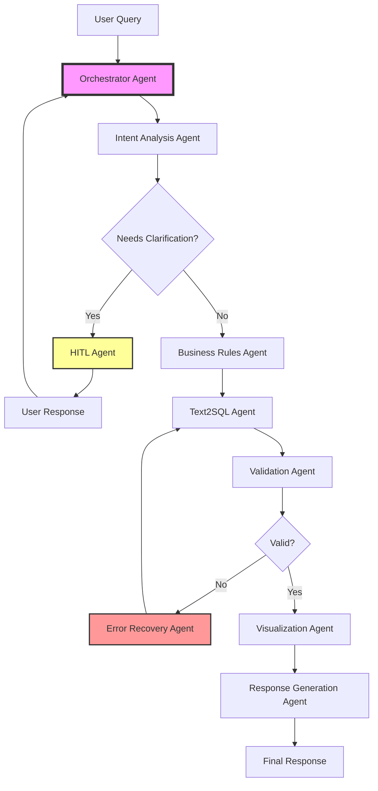

# Multi-Agent Report System Architecture

## 📋 Overview

Bu döküman, Report Agent'ın monolitik yapıdan **multi-agent state machine** mimarisine geçiş planını açıklar.

Mevcut yapı: **Tek graph, çok node**
Hedef yapı: **Orchestrator + Specialized Agents + Shared State**

---

## 🏗️ Agent Mimarisi

### 1️⃣ **Orchestrator Agent** (Report State Machine)

**Rol:** Workflow yönetimi ve koordinasyon

**Sorumluluklar:**
- Task delegation (hangi agent ne zaman çalışacak)
- Routing logic (agent'lar arası geçiş)
- State synchronization (state güncellemelerini yönetme)
- Agent communication hub (merkezi haberleşme)
- Error handling coordination (hata yönetimi)

**State Operations:**
```python
Input: user_query, session_context
Output: active_agent, agent_handoff, workflow_status
```

**Key Methods:**
- `route_to_agent(agent_name, context)`
- `handle_agent_completion(agent_name, result)`
- `coordinate_workflow()`

---

### 2️⃣ **Intent Analysis Agent**

**Rol:** Kullanıcı intent'ini anlama ve sınıflandırma

**Capabilities:**
- Intent classification (new_query, modify_filter, follow_up, visualization_request)
- Query type detection (ranking, comparison, time_series, single_value, etc.)
- Reference detection (önceki sonuçlara referans var mı?)
- Context analysis (conversation history analizi)
- Confidence scoring

**State Operations:**
```python
Input:
  - user_query
  - conversation_history
  - last_query_results

Output:
  - _intent_type: str
  - query_type: str
  - query_type_confidence: float
  - reference_context: Dict
  - _needs_clarification: bool
```

**Sub-components:**
- Intent classifier (LLM-driven)
- Query type analyzer (pattern matching + LLM)
- Reference detector (context-aware)

**Communication:**
```
Orchestrator → Intent Agent → State Update → Orchestrator
                              ↓
                     (if needs_clarification)
                              ↓
                         HITL Agent
```

---

### 3️⃣ **Text2SQL Agent**

**Rol:** Natural Language → SQL dönüşümü ve execution

**Sub-agents:**

#### 3.1 SQL Architect
- Intent parsing (user query → structured steps)
- Column mapping (natural language → DB columns)
- Filter extraction
- Aggregation planning

#### 3.2 Query Builder
- SQL generation (step-by-step)
- Business rule application
- CTE handling
- Query optimization

#### 3.3 SQL Executor
- Query execution
- Result fetching
- Error handling

#### 3.4 Value Resolver
- Fuzzy matching (kullanıcı input → DB values)
- Did-you-mean suggestions
- Multi-value resolution

**State Operations:**
```python
Input:
  - parsed_intent: Dict
  - schema_metadata: Dict
  - business_rules: Dict
  - applied_filters: List

Output:
  - sql_queries: List[str]
  - results: List[Dict]
  - resolved_steps: List[Dict]
  - resolution_metadata: Dict
```

**Error Handling:**
- SQL syntax errors → Error Recovery Agent
- Value resolution failures → HITL Agent
- Execution timeouts → Retry logic

---

### 4️⃣ **HITL Agent** (Human-in-the-Loop)

**Rol:** Ambiguity handling ve kullanıcı etkileşimi

**Capabilities:**
- Ambiguity detection (6 priority levels)
- Question building (context-aware, user-friendly)
- User response processing
- Clarification routing
- Infinite loop protection

**Ambiguity Types (Priority Order):**
1. **Context Ambiguity** - Mevcut filtrelerle devam mı, yeni sorgu mu?
2. **Prompt Scope Ambiguity** - Sorgu çok kısa/belirsiz
3. **Intent Ambiguity** - Kullanıcı ne yapmak istiyor?
4. **Query Type Ambiguity** - Hangi analiz türü? (confidence < 0.7)
5. **Column Ambiguity** - Hangi kolon kullanılacak?
6. **Value Ambiguity** - Hangi değer seçilecek?

**State Operations:**
```python
Input:
  - ambiguity_context: AmbiguityContext
  - user_query: str
  - active_query_context: ActiveQueryContext

Output:
  - pending_question: PendingQuestion
  - user_clarification: str
  - clarification_count: int
  - waiting_for_user_input: bool
```

**Question Builder:**
- Type-specific templates
- Rich formatting (emojis, sections)
- Context summaries
- Clear option presentation

**Communication:**
```
Any Agent → Detects Ambiguity → HITL Agent
                                     ↓
                              Asks User
                                     ↓
                              User Responds
                                     ↓
                         Updates State → Returns to Orchestrator
```

---

### 5️⃣ **Validation Agent**

**Rol:** Kalite kontrolü ve doğrulama

**Responsibilities:**

#### 5.1 SQL Validation
- Syntax checking
- Pattern matching (query_type vs SQL structure)
- GROUP BY validation
- Performance checks

#### 5.2 Entity Validation
- Entity completeness (comparison needs 2+ entities)
- Entity resolution (values exist in DB?)
- Cross-reference validation

#### 5.3 Result Validation
- Empty result handling
- Data quality checks
- Anomaly detection

#### 5.4 Business Rule Compliance
- Required rules applied?
- Rule conflicts?
- Compliance scoring

**State Operations:**
```python
Input:
  - sql_queries: List[str]
  - results: List[Dict]
  - query_type: str
  - applied_business_rules: List

Output:
  - validation_errors: List[str]
  - validation_warnings: List[str]
  - _entity_validation_done: bool
  - compliance_score: float
```

**Validation Flow:**
```
Text2SQL Agent → Validation Agent → Check
                                      ↓
                              (if errors found)
                                      ↓
                        Error Recovery Agent or HITL Agent
```

---

### 6️⃣ **Visualization Agent**

**Rol:** Görselleştirme kararı ve rendering

**Capabilities:**

#### 6.1 Chart Selection
- Query type-driven mapping
- Data shape analysis
- User preference detection
- Fallback logic

#### 6.2 Configuration
- Chart type (bar, line, pie, scatter, table)
- Axis configuration
- Color schemes
- Responsive settings

#### 6.3 Rendering
- Data formatting
- Chart generation
- Export options

**Query Type Mapping:**
```python
QUERY_TYPE_VIZ_MAPPING = {
    "ranking": "bar_chart",
    "comparison": "bar_chart",
    "time_series": "line_chart",
    "time_series_comparison": "line_chart",
    "single_value": "number_card",
    "aggregation": "bar_chart",
    "distribution": "pie_chart",
    "trend": "line_chart"
}
```

**State Operations:**
```python
Input:
  - query_type: str
  - results: List[Dict]
  - user_query: str
  - data_shape: Dict

Output:
  - _viz_decision: Dict {
      needs_graph: bool,
      output_type: str,
      chart_type: str,
      chart_config: Dict
    }
  - visualization_output: Dict
```

**Decision Priority:**
1. User explicit request ("grafik olarak", "çubuk grafik")
2. Query type mapping
3. Data shape analysis
4. Default (table)

---

### 7️⃣ **Response Generation Agent**

**Rol:** Natural language yanıt oluşturma

**Responsibilities:**

#### 7.1 Result Formatting
- Natural language summary
- Metric highlighting
- Comparison phrasing
- Trend descriptions

#### 7.2 Business Insights
- Key findings extraction
- Anomaly highlighting
- Recommendation generation

#### 7.3 Follow-up Suggestions
- Smart next questions
- Drill-down options
- Related analyses

**State Operations:**
```python
Input:
  - results: List[Dict]
  - query_type: str
  - user_query: str
  - business_context: BusinessContext

Output:
  - final_response: str
  - key_insights: List[str]
  - suggested_follow_ups: List[str]
```

**Response Templates by Query Type:**
- `single_value`: "Toplam {metric}: {value}"
- `ranking`: "En çok {metric} yapan {top_n} {entity}:"
- `comparison`: "{entity1} vs {entity2}: {metric} karşılaştırması"
- `time_series`: "Son {period} içinde {metric} trendi"

---

### 8️⃣ **Business Rules Agent**

**Rol:** İş kuralları yönetimi ve uygulama

**Capabilities:**

#### 8.1 Rule Matching
- Semantic similarity (vector-based)
- Keyword matching
- Context-aware scoring
- Default rule handling

#### 8.2 Rule Application
- SQL component merging
- Conflict resolution
- Priority ordering

#### 8.3 Context Building
- LLM prompt generation
- Rule documentation
- Compliance tracking

**State Operations:**
```python
Input:
  - user_query: str
  - parsed_intent: Dict
  - business_rules: Dict (from config)

Output:
  - applied_business_rules: List[Dict]
  - business_rules_context: str
  - merged_sql_components: Dict {
      aggregation: str,
      filter: str,
      group_by: str,
      having: str
    }
```

**Rule Structure:**
```json
{
  "id": "iade_dusulmus",
  "description": "İadelerin toplam cirodan çıkarılması",
  "modules": ["MasterReports"],
  "sql": {
    "aggregation": "SUM(CASE WHEN DocumentTypeIsReturn = 1 THEN -Amount ELSE Amount END)"
  },
  "is_default": true
}
```

---

### 9️⃣ **Schema Agent**

**Rol:** Database schema metadata yönetimi

**Responsibilities:**

#### 9.1 Column Metadata
- Human-readable descriptions
- Data type information
- Value examples
- Usage hints

#### 9.2 Table Selection
- Table detection from query
- Multi-table join logic
- View handling

#### 9.3 Relationship Mapping
- Foreign key detection
- Join path optimization

#### 9.4 Metadata Caching
- Runtime metadata discovery
- Embedding-based search
- Cache invalidation

**State Operations:**
```python
Input:
  - detected_tables: List[str]
  - user_query: str

Output:
  - schema_metadata: Dict {
      "ColumnName": "Human-readable description"
    }
  - enriched_metadata: Dict
  - table_relationships: List[Dict]
```

**Metadata Sources:**
1. Config files (`column_metadata.json`)
2. Runtime discovery (INFORMATION_SCHEMA)
3. Embedding store (semantic search)

---

### 🔟 **Error Recovery Agent**

**Rol:** Self-healing ve hata yönetimi

**Capabilities:**

#### 10.1 SQL Error Analysis
- Error pattern detection
- Root cause identification
- Common pitfall recognition

#### 10.2 Auto-correction
- Syntax fixes
- Column name corrections
- Aggregation fixes
- GROUP BY repairs

#### 10.3 Retry Logic
- Smart retry strategies
- Exponential backoff
- Max retry limits
- Alternative approaches

#### 10.4 Fallback Strategies
- Simplified query generation
- Partial result handling
- Graceful degradation

**State Operations:**
```python
Input:
  - sql_error_history: List[Dict]
  - failed_sql: str
  - error_message: str

Output:
  - corrected_sql: str
  - retry_count: int
  - recovery_strategy: str
  - error_analysis: Dict
```

**Error Categories:**
1. **Syntax errors** → Auto-fix
2. **Column not found** → Schema Agent lookup
3. **Aggregation errors** → Query Builder retry
4. **Value resolution failures** → HITL Agent
5. **Timeout errors** → Query simplification

---

## 📊 Ortak State Yapısı

```python
from typing import TypedDict, List, Optional, Dict, Any
from langchain_core.messages import BaseMessage

class SharedReportState(TypedDict):
    """
    Tüm agentların paylaştığı ortak state.
    Her agent state'i okuyabilir ve güncelleyebilir.
    """

    # =========================================================================
    # Core Fields
    # =========================================================================
    messages: List[BaseMessage]              # Conversation messages
    user_query: str                          # Current user query
    session_id: str                          # Session tracking

    # =========================================================================
    # Agent Communication
    # =========================================================================
    active_agent: str                        # Currently active agent name
    agent_handoff: Dict[str, Any]            # Agent transition metadata
    workflow_status: str                     # "in_progress", "completed", "error"

    # =========================================================================
    # Intent Analysis Agent
    # =========================================================================
    _intent_type: str                        # "new_query", "modify_filter", etc.
    _confidence: float                       # Intent confidence (0.0-1.0)
    query_type: str                          # "ranking", "comparison", etc.
    query_type_confidence: float             # Query type confidence
    reference_context: Dict[str, Any]        # Follow-up query context
    _needs_clarification: bool               # Should ask user?

    # =========================================================================
    # Text2SQL Agent
    # =========================================================================
    parsed_intent: Dict[str, Any]            # Structured query intent
    enriched_metadata: Dict[str, Any]        # Column metadata
    resolved_steps: List[Dict[str, Any]]     # Resolved query steps
    resolution_metadata: Dict[str, Any]      # Value resolution details
    sql_queries: List[str]                   # Generated SQL
    results: List[Dict[str, Any]]            # Query results

    # =========================================================================
    # HITL Agent
    # =========================================================================
    ambiguity_context: Optional[Any]         # AmbiguityContext object
    pending_question: Optional[Dict]         # Question for user
    user_clarification: Optional[str]        # User's answer
    waiting_for_user_input: bool             # Interrupt flag
    clarification_count: int                 # Loop protection

    # =========================================================================
    # Validation Agent
    # =========================================================================
    validation_errors: List[str]             # Validation errors
    validation_warnings: List[str]           # Warnings
    _entity_validation_done: bool            # Entity validation complete?
    compliance_score: float                  # Business rule compliance

    # =========================================================================
    # Visualization Agent
    # =========================================================================
    _viz_decision: Dict[str, Any]            # Visualization decision
    visualization_output: Dict[str, Any]     # Rendered visualization

    # =========================================================================
    # Response Generation Agent
    # =========================================================================
    final_response: str                      # Natural language response
    key_insights: List[str]                  # Business insights
    suggested_follow_ups: List[str]          # Smart next questions

    # =========================================================================
    # Business Rules Agent
    # =========================================================================
    business_rules: Dict[str, Any]           # Loaded business rules
    applied_business_rules: List[Dict]       # Applied rules
    business_rules_context: str              # LLM context string
    merged_sql_components: Dict[str, Any]    # Merged SQL components

    # =========================================================================
    # Schema Agent
    # =========================================================================
    schema_metadata: Dict[str, Any]          # Column metadata
    detected_tables: List[str]               # Detected table names
    table_relationships: List[Dict]          # Table joins

    # =========================================================================
    # Error Recovery Agent
    # =========================================================================
    sql_error_history: List[Dict[str, Any]]  # Error history
    retry_count: int                         # Retry counter
    recovery_strategy: str                   # Active recovery strategy

    # =========================================================================
    # Context & History
    # =========================================================================
    active_query_context: Optional[Dict]     # Current query context
    query_history: List[Dict]                # Query checkpoints
    conversation_history: List[Dict]         # Conversation entries
    conversation_turn: int                   # Turn counter
```

---

## 🔄 Agent Communication Flow



### Detailed Flow

**1. User Query Entry**
```
User → Orchestrator Agent
         ↓
   State: { user_query, session_id }
```

**2. Intent Analysis**
```
Orchestrator → Intent Analysis Agent
                      ↓
   Analyze query → Classify intent → Detect query type
                      ↓
   State Update: { _intent_type, query_type, query_type_confidence }
                      ↓
   Return to Orchestrator
```

**3. Ambiguity Check (Conditional)**
```
Orchestrator → Check _needs_clarification
                      ↓
         (if true) → HITL Agent
                      ↓
                Ask user question
                      ↓
         User responds → Update state
                      ↓
         Return to Orchestrator
```

**4. Business Rules Application**
```
Orchestrator → Business Rules Agent
                      ↓
   Match rules → Merge SQL components
                      ↓
   State Update: { applied_business_rules, merged_sql_components }
                      ↓
   Return to Orchestrator
```

**5. SQL Generation & Execution**
```
Orchestrator → Text2SQL Agent
                      ↓
   SQL Architect → Query Builder → Executor
                      ↓
   State Update: { sql_queries, results }
                      ↓
   Return to Orchestrator
```

**6. Validation**
```
Orchestrator → Validation Agent
                      ↓
   Validate SQL → Validate results
                      ↓
         (if errors) → Error Recovery Agent → Retry
                      ↓
   State Update: { validation_errors, _entity_validation_done }
                      ↓
   Return to Orchestrator
```

**7. Visualization**
```
Orchestrator → Visualization Agent
                      ↓
   Decide chart type → Configure → Render
                      ↓
   State Update: { _viz_decision, visualization_output }
                      ↓
   Return to Orchestrator
```

**8. Response Generation**
```
Orchestrator → Response Generation Agent
                      ↓
   Format results → Extract insights → Suggest follow-ups
                      ↓
   State Update: { final_response, key_insights, suggested_follow_ups }
                      ↓
   Return to Orchestrator
```

**9. Complete**
```
Orchestrator → Update workflow_status = "completed"
             → Return to User
```

---

## 💡 Avantajlar

### 1. **Modülerlik**
- Her agent bağımsız geliştirilebilir
- Yeni agentlar kolayca eklenebilir
- Agent'lar ayrı test edilebilir
- Kod organizasyonu daha net

### 2. **Ölçeklenebilirlik**
- Agentlar paralel çalışabilir
- Resource allocation optimize edilebilir
- Load balancing mümkün
- Horizontal scaling kolay

### 3. **Bakım Kolaylığı**
- Her agent kendi sorumluluğuna odaklanır (Single Responsibility)
- Bug isolation daha kolay
- Version management basit
- Debugging hızlı

### 4. **Esneklik**
- Agentlar runtime'da eklenebilir/çıkarılabilir
- A/B testing mümkün
- Feature flags agent seviyesinde
- Gradual rollout yapılabilir

### 5. **Test Edilebilirlik**
- Unit tests agent bazında
- Integration tests agent pairs için
- Mock agents kolayca oluşturulabilir
- Test coverage yüksek

### 6. **Monitoring & Observability**
- Agent-level metrics
- Performance tracking per agent
- Error rates per agent
- Agent communication tracing

---

## 🚀 Implementasyon Planı

### Phase 1: Foundation (Week 1-2)

**1.1 Shared State Protocol**
```python
# src/agents/shared_state.py
- Define SharedReportState
- State update protocols
- State validation
```

**1.2 Orchestrator Agent**
```python
# src/agents/orchestrator.py
- Agent registry
- Routing logic
- Communication hub
- Workflow management
```

**1.3 Agent Base Class**
```python
# src/agents/base_agent.py
class BaseAgent:
    def __init__(self, name: str, state: SharedReportState):
        self.name = name
        self.state = state

    async def run(self) -> Dict[str, Any]:
        """Execute agent logic and return state updates"""
        raise NotImplementedError

    def update_state(self, updates: Dict[str, Any]):
        """Update shared state"""
        ...
```

---

### Phase 2: Core Agents (Week 3-4)

**2.1 Intent Analysis Agent**
```python
# src/agents/intent_agent.py
- Migrate from nodes.classify_intent
- Add agent communication
- Test independently
```

**2.2 Text2SQL Agent**
```python
# src/agents/text2sql_agent.py
- Extract sql_architect, query_builder, executor
- Create sub-agents
- Coordinate SQL workflow
```

**2.3 HITL Agent**
```python
# src/agents/hitl_agent.py
- Migrate ambiguity detection
- Question building
- User interaction
```

---

### Phase 3: Support Agents (Week 5-6)

**3.1 Validation Agent**
```python
# src/agents/validation_agent.py
- SQL validation
- Entity validation
- Result validation
```

**3.2 Business Rules Agent**
```python
# src/agents/business_rules_agent.py
- Rule matching
- SQL component merging
```

**3.3 Schema Agent**
```python
# src/agents/schema_agent.py
- Metadata management
- Column mapping
```

---

### Phase 4: Advanced Features (Week 7-8)

**4.1 Visualization Agent**
```python
# src/agents/visualization_agent.py
- Chart selection
- Rendering
```

**4.2 Response Generation Agent**
```python
# src/agents/response_agent.py
- NL generation
- Insights extraction
```

**4.3 Error Recovery Agent**
```python
# src/agents/error_recovery_agent.py
- Error analysis
- Auto-correction
- Retry logic
```

---

### Phase 5: Integration & Testing (Week 9-10)

**5.1 Integration Tests**
- End-to-end workflows
- Agent communication tests
- State consistency tests

**5.2 Performance Optimization**
- Parallel agent execution
- State update batching
- Caching strategies

**5.3 Monitoring Setup**
- Agent metrics
- Tracing
- Alerting

---

## 📁 Proje Yapısı

```
src/
├── agents/
│   ├── __init__.py
│   ├── base_agent.py                    # Base agent class
│   ├── orchestrator.py                  # Main orchestrator
│   ├── intent_agent.py                  # Intent analysis
│   ├── text2sql_agent/
│   │   ├── __init__.py
│   │   ├── architect.py                 # SQL architect
│   │   ├── builder.py                   # Query builder
│   │   ├── executor.py                  # SQL executor
│   │   └── resolver.py                  # Value resolver
│   ├── hitl_agent.py                    # Human-in-the-loop
│   ├── validation_agent.py              # Validation
│   ├── business_rules_agent.py          # Business rules
│   ├── schema_agent.py                  # Schema metadata
│   ├── visualization_agent.py           # Visualization
│   ├── response_agent.py                # Response generation
│   └── error_recovery_agent.py          # Error recovery
│
├── state/
│   ├── __init__.py
│   ├── shared_state.py                  # Shared state definition
│   ├── state_manager.py                 # State updates & sync
│   └── state_validators.py             # State validation
│
├── communication/
│   ├── __init__.py
│   ├── protocols.py                     # Communication protocols
│   ├── message_bus.py                   # Event-driven messaging
│   └── agent_registry.py                # Agent discovery
│
└── graphs/
    └── report/
        └── legacy/                      # Old monolithic code (backup)
```

---

## 🔧 Örnek Agent Implementation

```python
# src/agents/intent_agent.py

from typing import Dict, Any
from .base_agent import BaseAgent
from ..state.shared_state import SharedReportState
import logging

logger = logging.getLogger(__name__)

class IntentAnalysisAgent(BaseAgent):
    """
    Intent Analysis Agent - Kullanıcı intent'ini anlar ve sınıflandırır.
    """

    def __init__(self, state: SharedReportState, llm):
        super().__init__(name="IntentAnalysisAgent", state=state)
        self.llm = llm

    async def run(self) -> Dict[str, Any]:
        """
        Intent analysis workflow.

        Returns:
            State updates to be merged into shared state
        """
        logger.info(f"[{self.name}] Starting intent analysis")

        user_query = self.state.get("user_query")
        conversation_history = self.state.get("conversation_history", [])

        # 1. Classify intent
        intent_result = await self._classify_intent(user_query, conversation_history)

        # 2. Detect query type
        query_type_result = await self._detect_query_type(user_query, intent_result)

        # 3. Check for references
        reference_context = await self._detect_references(user_query, conversation_history)

        # 4. Decide if clarification needed
        needs_clarification = self._check_clarification_needed(
            intent_result,
            query_type_result
        )

        logger.info(
            f"[{self.name}] Intent: {intent_result['intent_type']}, "
            f"Query Type: {query_type_result['query_type']}, "
            f"Confidence: {query_type_result['confidence']:.2f}"
        )

        # Return state updates
        return {
            "_intent_type": intent_result["intent_type"],
            "_confidence": intent_result["confidence"],
            "query_type": query_type_result["query_type"],
            "query_type_confidence": query_type_result["confidence"],
            "reference_context": reference_context,
            "_needs_clarification": needs_clarification,
            "active_agent": self.name
        }

    async def _classify_intent(self, user_query: str, history: list) -> Dict[str, Any]:
        """Classify user intent using LLM"""
        # Implementation...
        pass

    async def _detect_query_type(self, user_query: str, intent: Dict) -> Dict[str, Any]:
        """Detect query type (ranking, comparison, etc.)"""
        # Implementation...
        pass

    async def _detect_references(self, user_query: str, history: list) -> Dict[str, Any]:
        """Detect references to previous results"""
        # Implementation...
        pass

    def _check_clarification_needed(self, intent: Dict, query_type: Dict) -> bool:
        """Check if user clarification is needed"""
        if query_type["confidence"] < 0.7:
            return True
        if intent["confidence"] < 0.65:
            return True
        return False
```

---

## 📊 Migration Strategy

### Option 1: Big Bang Migration
- Tüm sistem bir seferde geçirilir
- Risk: Yüksek
- Süre: 8-10 hafta
- Avantaj: Hızlı geçiş

### Option 2: Gradual Migration (ÖNERİLEN)
- Her agent birer birer geçirilir
- Risk: Düşük
- Süre: 10-12 hafta
- Avantaj: Test edilerek ilerlenebilir

**Gradual Migration Planı:**

**Week 1-2:** Foundation + Orchestrator
**Week 3:** Intent Agent migrate
**Week 4:** Text2SQL Agent migrate
**Week 5:** HITL Agent migrate
**Week 6:** Validation + Business Rules Agents
**Week 7:** Schema + Error Recovery Agents
**Week 8:** Visualization + Response Agents
**Week 9-10:** Integration testing + Performance tuning
**Week 11-12:** Production rollout

---

## 🎯 Success Metrics

### Performance Metrics
- **Latency:** Agent communication overhead < 50ms
- **Throughput:** 100+ queries/minute
- **Parallelization:** 3-5x speedup for independent agents

### Quality Metrics
- **Test Coverage:** >85% per agent
- **Error Rate:** <1% per agent
- **Recovery Rate:** >95% for recoverable errors

### Developer Experience
- **Build Time:** <2 minutes
- **Test Time:** <5 minutes
- **Agent Development Time:** 1-2 days per new agent

---

## 🔮 Future Enhancements

### 1. Agent Learning & Adaptation
- Agent performance tracking
- Automatic parameter tuning
- A/B testing framework

### 2. Advanced Orchestration
- Dynamic agent selection
- Load balancing
- Circuit breakers

### 3. Multi-Modal Agents
- Voice input agent
- Image analysis agent
- Document parsing agent

### 4. Distributed Deployment
- Agent microservices
- Message queue integration (Kafka, RabbitMQ)
- Service mesh (Istio)

---

## 📚 References

### LangGraph Multi-Agent Patterns
- [LangGraph Documentation](https://langchain-ai.github.io/langgraph/)
- [Multi-Agent Collaboration](https://langchain-ai.github.io/langgraph/tutorials/multi_agent/)

### State Management
- [Shared State Pattern](https://langchain-ai.github.io/langgraph/concepts/low_level/#state)
- [State Reducers](https://langchain-ai.github.io/langgraph/concepts/low_level/#reducers)

### Agent Communication
- [Human-in-the-Loop](https://langchain-ai.github.io/langgraph/concepts/human_in_the_loop/)
- [Subgraphs & Multi-Agent](https://langchain-ai.github.io/langgraph/concepts/multi_agent/)

---

## ✅ Next Steps

1. **Review Architecture** - Tüm stakeholder'lar ile review
2. **Approve Migration Plan** - Gradual vs Big Bang kararı
3. **Setup Development Environment** - Agent development tools
4. **Start Phase 1** - Foundation implementation
5. **Create First Agent** - Intent Analysis Agent prototype

---

**Document Version:** 1.0
**Last Updated:** 2026-02-13
**Author:** Claude + Development Team
**Status:** 🟡 Draft - Review Needed
